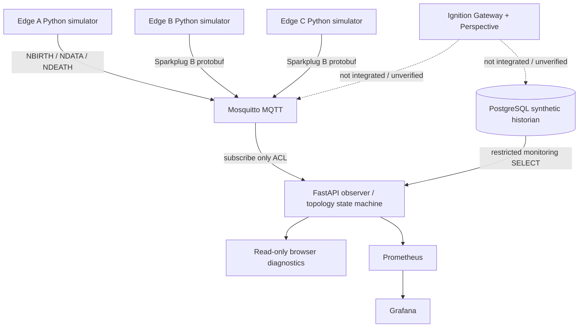

# SignalAtlas — Read-Only SCADA Topology & Observability Lab

Industrial SCADA environments often have health information spread across gateways,
brokers, databases, and edge devices. SignalAtlas creates one read-only view showing
how those systems connect and where connectivity has failed.

> **Evidence boundary (2026-10-31):** This is a synthetic educational laboratory.
> The Python state-machine/API tests ran locally; live Docker MQTT, PostgreSQL,
> Grafana and Ignition integrations have NOT been run or verified in this environment.
> The built-in browser is a diagnostic preview, NOT an Ignition Perspective project.
> No SCADA server, real device, vendor module, AWS integration, or remote site is connected.

## Architecture



Three distinct edge identities publish synthetic telemetry. Each birth, data, death
and reconnection event is decoded by the observer; the observer is denied MQTT
publish rights by broker ACL. Observed state transitions appear in topology,
incidents and metrics. The broker is hosted locally, not on AWS. The PostgreSQL
seed data is simulated; the monitoring SQL is real read-only statistics queries.

## Requirements

- Docker Desktop or Docker Engine + Compose V2, and Python 3.11+
- Approximately 4 GB free memory recommended for all local services (not benchmarked)
- Optional: GNU Make; on Windows without Make, invoke the corresponding Python and
  `docker compose` commands manually
- For Python-only tests: `python -m pip install -e '.[dev]'`

## Run the local Docker laboratory

```bash
cp .env.example .env
# Edit .env: populate ALL eight distinct passwords (12+ chars each, using letters, digits, underscore or hyphen)
python tools/bootstrap.py
# Validate the compose model without starting anything
docker compose config --quiet
# Start the actual services
docker compose up -d --build
```

With Make installed, `make up` performs bootstrap and startup. Broker authentication
is generated as hashed local config in `runtime/mosquitto/passwords` (ignored by Git).
If changing passwords, re-run bootstrap and recreate the broker to load the new file.

Expected local URLs after successful startup (NOT verified here):

- http://127.0.0.1:8000 — read-only topology diagnostic browser
- http://127.0.0.1:8000/api/topology — evidence-backed REST snapshot
- http://127.0.0.1:8000/docs — automatic OpenAPI docs
- http://127.0.0.1:3000 — Grafana with configured Prometheus datasource
- http://127.0.0.1:9090 — Prometheus

For status, run `docker compose ps` and `docker compose logs -f topology-api broker`.
`/health` means only that the API process is alive. `/ready` returns 200 only after
all three MQTT observation subscriptions have acknowledged. Edge containers wait for
that readiness check on first startup so initial birth messages are not missed.

## Local development

```bash
python -m pip install -e '.[dev]'
make test                  # pytest
make lint                  # ruff lint + formatting check
make demo                  # read-only status CLI and demo directions
make fault-demo            # guided edge-b graceful failure/recovery
make down                  # preserve volumes
```

Without Make: `python -m pytest -q`, `python -m ruff check .`,
`python -m ruff format --check .`, `python -m signalatlas.diagnostics`.
Use `python -m compileall -q src tests tools` for a quick syntax check.

## API contract

| Route | Meaning |
|---|---|
| `GET /health` | API liveness (does not imply connected equipment) |
| `GET /ready` | MQTT subscriptions acknowledged |
| `GET /api/topology` | Components, links, incidents, observations |
| `GET /api/nodes` | All known components |
| `GET /api/nodes/{id}` | Single component or 404 |
| `GET /api/links` | Link states, reason and provenance |
| `GET /api/incidents` | Bounded in-memory state transitions |
| `GET /api/database` | Live read-only PostgreSQL statistics or explicit unavailable |
| `GET /metrics` | Prometheus observations |
| `GET /` | Diagnostic operator preview (not Perspective) |

Status `HEALTHY`, `DEGRADED`, `STALE`, `OFFLINE`, `UNKNOWN` is based on actual
received events or local observer timeouts. No fake data fills absent readings.
`last_seen` is the **receiver** timestamp, not an untrusted device clock. Missing
Ignition metrics and the unverified Ignition links remain `UNKNOWN`.

## Monitoring and simulated telemetry

CPU and memory represent the real *simulator container* resource usage, not an
industrial controller. `device_temperature_c_simulated` and
`scan_cycle_ms_simulated` are deterministic synthetic fields; they're not hardware
sensors. A special `SIMULATE_HIGH_CPU=1` edge environment setting reports
synthetic CPU at 96% for state-transition demonstrations, **without consuming CPU**.
The synthetic historian is seeded by a distinct writer-capable setup identity;
monitor connections use a separate restricted role.

## Not yet delivered

Ignition Gateway setup, Cirrus Link MQTT module operation, Perspective project export,
Gateway system-tag telemetry, full five-dashboard Grafana coverage, RDS/EC2,
replication, slow-query detector, comprehensive fault orchestrator, live
MQTT↔PostgreSQL integration proof, published CI run, and production-grade security
certification are **unimplemented or unverified**. See `docs/backlog.md`.

## Design and learning documentation

- [Architecture and state semantics](docs/architecture.md)
- [Sparkplug B lifecycle and protocol scope](docs/sparkplug.md)
- [Read-only threat model](docs/security.md)
- [Failure diagnosis](docs/troubleshooting.md)
- [3–5 minute demo procedure](docs/demo.md)
- [Ignition deployment decision](ignition/README.md)
- [Milestones, issue drafts and acceptance gates](docs/backlog.md)

### Skills actually verified in this artifact environment

25 unit/API/security-boundary tests passed on Python 3.13, including 5-state transitions,
`bdSeq` correlation, sequence wrap, invalid payload rejection and API shape.
That demonstrates exercised Python logic. **It does not establish** real Ignition,
MQTT broker interoperability, SCADA experience, Grafana dashboard rendering,
AWS permissions or PostgreSQL privilege enforcement; those require independent
live execution and evidence.

For the exact packaged repository tree, see [`docs/REPO_TREE.txt`](docs/REPO_TREE.txt).
